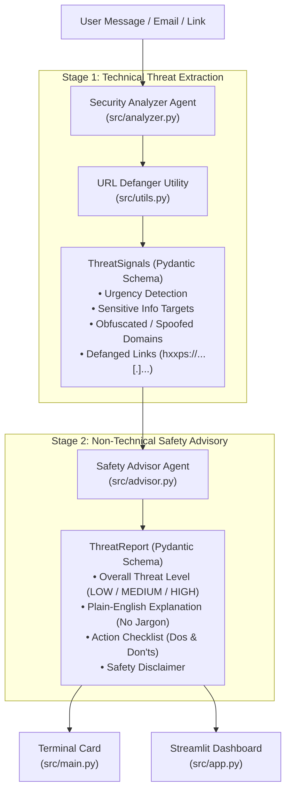

# Cyber Guardian 🛡️

**Cyber Guardian** is a lightweight, AI-driven cyber safety assistant designed to detect phishing hooks, social engineering tactics, artificial urgency drivers, and credential harvesting attempts from suspicious text, emails, SMS messages, and links.

Built with a strict **two-agent architecture** powered by Google Gemini and schema validation with Pydantic.

---

## Architecture Overview



---

## Safety Guardrails
- **No Active Probing:** The system never resolves, pings, or browses untrusted URLs. All analysis is strictly static text and structural inspection.
- **Defanged URLs:** All links and domains are automatically converted to safe text representations (e.g., `hxxps://example[.]com`) to prevent accidental clicks.
- **Strict Schema Binding:** Both agents communicate through validated Pydantic models.

---

## Getting Started

### 1. Prerequisites
- Python 3.11+ (Tested on Python 3.13)
- Google Gemini API Key

### 2. Installation
Clone or navigate to the repository directory and install the required dependencies:
```bash
pip install -r requirements.txt
```

### 3. Environment Configuration (`.env`)
Create a `.env` file in the root directory and add your primary (and optional backup) Gemini API keys:
```env
GEMINI_API_KEY="your-primary-gemini-api-key"
GEMINI_API_KEY_BACKUP="your-backup-gemini-api-key" # Optional: auto-swapped upon 429 Rate Limits
```


---

## Usage Commands

### 1. Run the Unified CLI Card
```bash
# Run with the built-in phishing benchmark
python -m src.main --sample

# Run with custom suspicious text
python -m src.main "URGENT: Your account has been suspended. Click https://fake-bank-auth.com to restore access immediately."

# Interactive CLI mode
python -m src.main
```

### 2. Launch the Web Dashboard (Streamlit)
```bash
streamlit run src/app.py
```
*Open [http://localhost:8501](http://localhost:8501) in your browser.*

### 3. Launch the Standalone Desktop App (PyWebview)
```bash
py -3.13 run_app.py
```
*Launches Cyber Guardian inside a native, chromeless 1280x850 desktop window without requiring an external browser tab.*

### 4. Build the Standalone Windows Executable (`CyberGuardian.exe`)
```powershell
# Standard Windowed Production Build
.\build_exe.ps1

# Optional: Build with debug console output
.\build_exe.ps1 -Console
```
*Outputs a standalone one-file binary to `dist/CyberGuardian.exe`.*

### 5. Run the Automated Test Suite
```bash
pytest -v
```

---

## Project Structure

```text
cyber-guardian/
├── src/
│   ├── __init__.py        # Package initializer
│   ├── schemas.py         # Pydantic schemas (ThreatSignals, ThreatReport)
│   ├── utils.py           # Static URL defanger & EML parser utilities
│   ├── analyzer.py        # Role 1: Security Analyzer Agent
│   ├── advisor.py         # Role 2: Safety Advisor Agent
│   ├── main.py            # Unified CLI entry point & terminal report card
│   └── app.py             # Streamlit analyst dashboard (.txt/.eml upload & history)
├── tests/
│   ├── test_defang.py     # Unit tests for URL defanger
│   ├── test_eml.py        # Unit tests for RFC822 EML email parser
│   ├── test_schemas.py    # Schema validation tests
│   └── test_pipeline_mock.py # Integration test mocking LLM pipeline
├── requirements.txt       # Project dependencies
├── .env                   # Environment secrets
├── AGENTS.md              # Agent architecture specification
├── PRD.md                 # Product requirements document
└── README.md              # Project documentation
```

